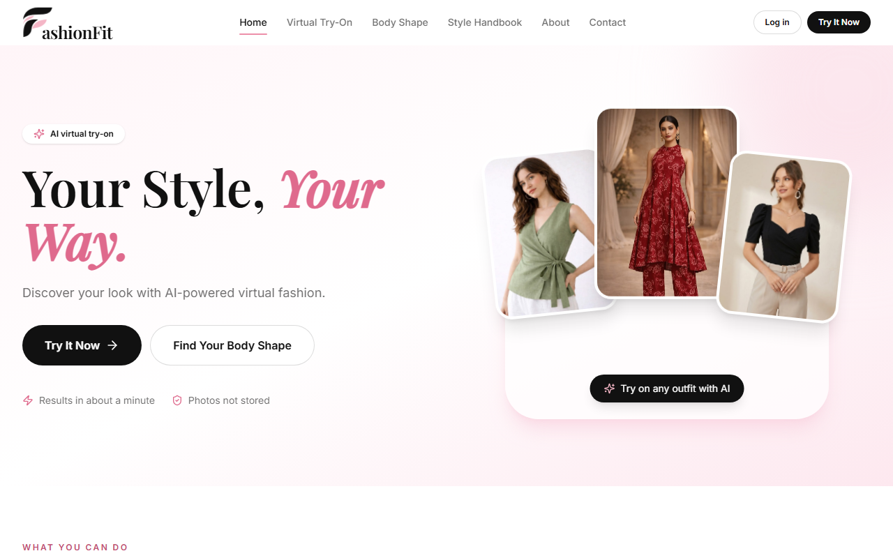
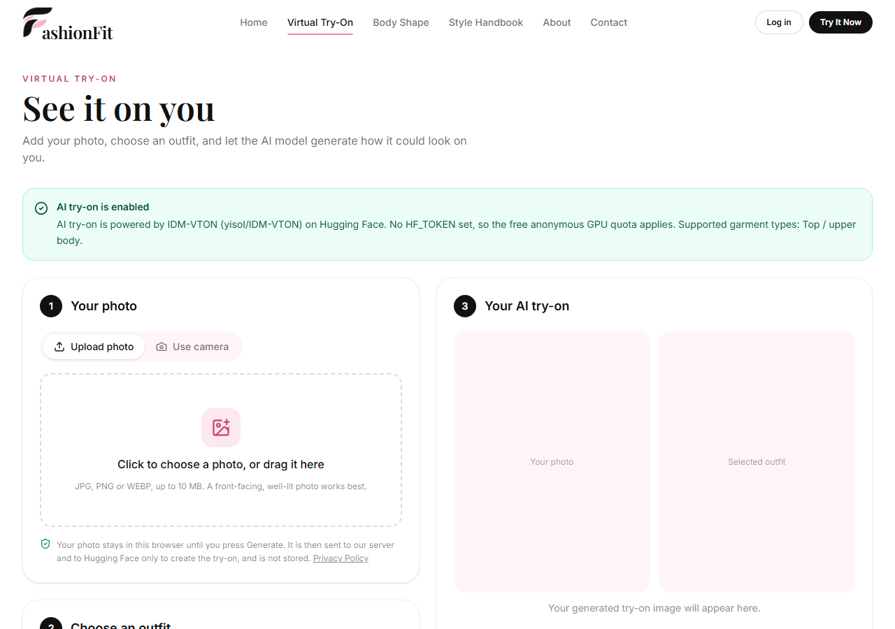
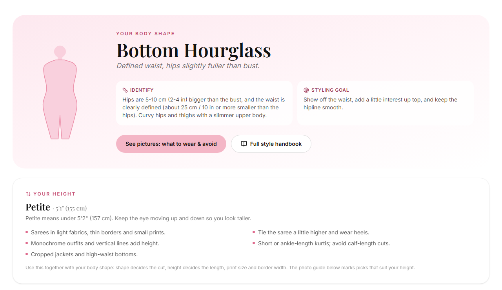
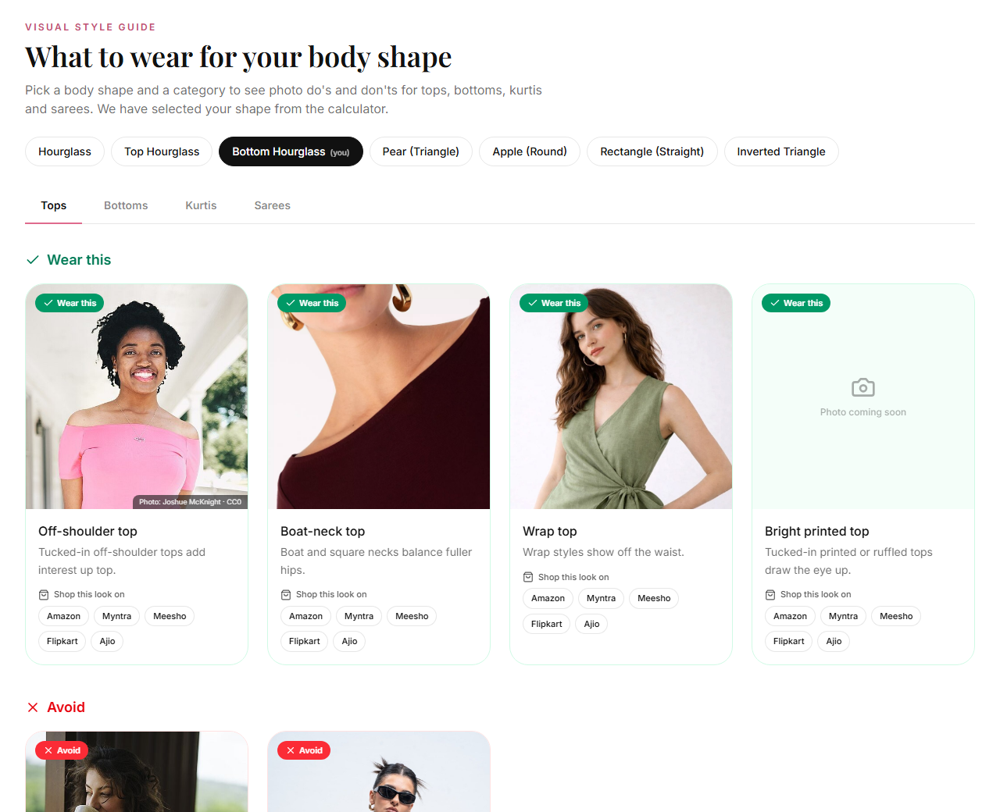
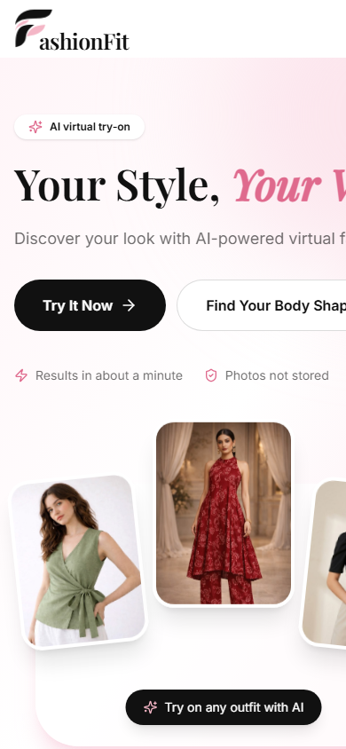

# Fashion Fit — AI Virtual Try-On & Body Shape Styling

Fashion Fit is a fashion styling website. Upload a photo (or take one with your camera), pick an outfit, and an
AI model generates an image of you wearing it. It also has a body shape calculator that uses your measurements
and height to suggest what to wear, with photo examples for tops, bottoms, kurtis and sarees.

Nothing is sold on the site. It's a styling tool, not a shop.

- **Frontend:** React 18, Vite, Tailwind CSS 4
- **Backend:** Python, Flask, Pillow, OpenCV, SQLite
- **AI model:** [IDM-VTON](https://github.com/yisol/IDM-VTON), a diffusion-based virtual try-on model, called through
  the public Hugging Face Space (free) or Replicate (paid)

## Screenshots

| Home | Virtual try-on |
|---|---|
|  |  |

| Body shape + height result | Style guide (wear / avoid) |
|---|---|
|  |  |

<p align="center"></p>

---

## Features

| Feature | Status |
|---|---|
| Home page (hero, what you can do, how it works, footer) and animated logo | Done |
| "Our outfits" in Virtual Try-On (the site owner's photos, listed in `frontend/src/data/tryOnGarments.js`), plus **upload your own clothing photo** to try on | Done |
| Photo upload (drag & drop, type/size validation, EXIF rotation fix) | Done |
| Camera capture (permission request, live preview, 3s timer, switch camera, retake, error messages) | Done |
| Photo quality check with OpenCV (face detection, blur, brightness) | Done |
| **AI virtual try-on (IDM-VTON via Hugging Face)** | **Done and tested end-to-end** (see "Testing" below) |
| AI try-on via Replicate | Implemented, **not tested** (needs a paid API token) |
| Before/after compare slider, side-by-side view, download result | Done |
| Sign up / log in (hashed passwords, signed tokens), profile, edit name, delete account | Done |
| Try-on history (only with explicit opt-in; stores the result, never the original photo) | Done |
| Body shape calculator following the "Dress for Your Body Shape - Indian Style Guide" handbook (7 women's and 5 men's shapes) with live silhouette, full saree / ethnic / office / casual / avoid advice and outfit picks. Runs in the browser, measurements never uploaded | Done |
| Height advice: optional height (cm or ft + in) puts you in Petite / Average / Tall, shows tips for your height and marks style guide picks that suit it or need care. Women's groups follow the handbook; men's groups use common cut-offs (the handbook has no men's height section) | Done |
| Style Handbook page (`/style-handbook`): measuring guide, shape patterns, styling principles, colour & skin tone, saree fabrics & drapes, blouse necklines, size notes, men's ethnic wear & fit checklist, cheat sheets | Done |
| Visual style guide (tops, bottoms, kurtis, sarees: wear / avoid per body shape) with the site owner's photos in `frontend/public/style-guide/my-photos/` and free-licence Wikimedia Commons photos (credited). Click any photo to see it full size | Done (41 of 49 items have a photo so far) |
| Contact form (validated, stored in SQLite), About, Privacy Policy, 404 page | Done |
| Responsive layout (mobile, tablet, desktop) | Done |

### Limitations

- **The free Hugging Face Space only supports upper-body garments** (tees, shirts, hoodies, blazers, kurtas,
  blouses). With that provider, bottoms and dresses are greyed out in the try-on picker and the reason is shown.
  Use the Replicate provider for lower-body garments and dresses.
- The free Space runs on shared GPUs. Requests can **queue**, and anonymous users get a **small daily GPU quota**.
  Adding a free `HF_TOKEN` raises the quota. When the quota runs out, the app shows a clear error message.
- A try-on usually takes **30–90 seconds**.
- If no provider is configured (`TRYON_PROVIDER=none`) or the backend is not running, the try-on page still
  works for uploading and choosing outfits, but clearly says AI try-on is not available. **It never shows a
  placeholder or overlay image as an AI result.**
- Outfit photos for try-on are listed in `frontend/src/data/tryOnGarments.js` and stored in
  `frontend/public/style-guide/my-photos/`. Photos showing only the garment give the best results.
- This is not a shop: there are no products for sale, prices or checkout. Store buttons in the style guide only open search results on other sites.

---

## Project structure

```
fashion fit/
├── frontend/                    React + Vite + Tailwind app
│   ├── public/style-guide/      Style guide photos; my-photos/ also holds the try-on outfits
│   ├── src/
│   │   ├── components/          Navbar, Footer, Logo, CameraCapture, PhotoInput, CompareSlider,
│   │   │                        GarmentPicker, StyleGuide, PhotoLightbox, ShapeAdvice, ...
│   │   ├── pages/               Home, TryOn, BodyShape, StyleHandbook, Login, Signup,
│   │   │                        Profile, About, Contact, Privacy, NotFound
│   │   ├── context/             AuthContext (login)
│   │   ├── services/            api.js, tryOnService.js, authService.js, storage.js, ...
│   │   ├── data/                tryOnGarments.js (try-on outfits), bodyShape.js, height.js,
│   │   │                        styleGuide.js, styleHandbook.js, stylePhotos.json
│   │   ├── App.jsx              Routes
│   │   └── main.jsx             Entry point
│   ├── vite.config.js           Dev server on port 5180, forwards /api to Flask
│   └── package.json
├── backend/                     Flask API
│   ├── app.py                   All API routes
│   ├── config.py                Settings from .env
│   ├── database.py              SQLite schema + helpers
│   ├── auth.py                  Password hashing, login tokens
│   ├── image_utils.py           Pillow + OpenCV: validation, quality checks, 3:4 fitting
│   ├── providers/               AI try-on providers (Hugging Face, Replicate, disabled)
│   ├── uploads/results/         Saved try-on results (only when the user opts in)
│   ├── requirements.txt
│   └── .env.example             Copy to .env
├── start-backend.bat            Double-click to start the backend (after setup)
├── start-frontend.bat           Double-click to start the frontend (after setup)
└── README.md
```

### How the AI try-on works

1. The browser sends the user's photo + the selected garment image to `POST /api/tryon` (Flask).
2. Flask validates both images (Pillow), fixes phone rotation, checks quality (OpenCV), and fits the photo onto
   a 768×1024 canvas without stretching it (empty space is filled with a blurred copy of the photo).
3. The selected provider sends both images to IDM-VTON, which masks the clothing area and **generates new
   pixels** for the garment that follow the person's pose and body.
4. Flask crops the result back to the original photo's framing and returns it. The original photo is never
   written to disk.

API keys only live in `backend/.env`. The frontend never sees them.

---

## Run it locally on Windows

### Prerequisites

- **Node.js 18 or newer** (tested with 22.14): https://nodejs.org
- **Python 3.10 or newer** (tested with 3.12): https://www.python.org/downloads/ (tick "Add Python to PATH")

Check them in PowerShell:

```powershell
node -v
python --version
```

### 1. Backend (first-time setup)

Open **PowerShell** in the project folder (`E:\fashion fit`) and run:

```powershell
cd backend
python -m venv venv
.\venv\Scripts\python.exe -m pip install --upgrade pip
.\venv\Scripts\python.exe -m pip install -r requirements.txt
Copy-Item .env.example .env
```

> Upgrading pip first matters: older pip versions fail with `CERTIFICATE_VERIFY_FAILED` on some Windows
> networks. New pip uses the Windows certificate store.

Start the backend:

```powershell
.\venv\Scripts\python.exe app.py
```

You should see:

```
  Fashion Fit API on http://localhost:5000
  AI try-on: ENABLED - AI try-on is powered by IDM-VTON (yisol/IDM-VTON) on Hugging Face. ...
```

Leave this window open.

### 2. Frontend (first-time setup)

Open a **second** PowerShell window in the project folder:

```powershell
cd frontend
npm install
npm run dev
```

Open **http://localhost:5180** in your browser.

> If PowerShell blocks `npm` with "running scripts is disabled", use `npm.cmd install` and `npm.cmd run dev`,
> or run `Set-ExecutionPolicy -Scope CurrentUser RemoteSigned` once.

### Next time

Double-click `start-backend.bat`, then `start-frontend.bat`. Or run these in two windows:

```powershell
cd backend;  .\venv\Scripts\python.exe app.py
cd frontend; npm run dev
```

### Production build (optional)

```powershell
cd frontend
npm run build      # output in frontend\dist
npm run preview    # serves the build; still needs the backend running
```

---

## Enabling AI try-on

Settings live in `backend/.env`. Restart the backend after changing it.

### Option A: Hugging Face (free, default)

```ini
TRYON_PROVIDER=huggingface
HF_SPACE=yisol/IDM-VTON
HF_TOKEN=            # optional but recommended
```

This works without an account. For a larger free GPU quota, create a free token at
https://huggingface.co/settings/tokens ("Read" access) and paste it into `HF_TOKEN`.

### Option B: Replicate (paid; supports tops, bottoms and dresses)

```ini
TRYON_PROVIDER=replicate
REPLICATE_API_TOKEN=r8_your_token_here
REPLICATE_MODEL=cuuupid/idm-vton
```

Create a token at https://replicate.com/account/api-tokens (billing must be enabled). This provider is
implemented against Replicate's HTTP API but was **not tested** while building this project, because that needs
a paid token.

### Option C: Disable AI

```ini
TRYON_PROVIDER=none
```

The site still works, and the try-on page explains that AI try-on is not enabled.

---

## Testing that was done

- **Real AI try-on:** a sample person photo from the IDM-VTON Space's example folder, with the sample pink
  hoodie and sky-blue Oxford shirt, run through the full stack (browser proxy → Flask → Hugging Face
  IDM-VTON). Each returned a generated image of the person wearing the garment in about 37–40 seconds.
- **Try-on history:** saved with opt-in, listed, downloaded and deleted through the API.
- **API tests:** sign-up validation, login with a wrong password (401), contact form, invalid image upload (400), try-on with AI disabled (503 with an explanation).
- **Frontend:** production build passes. Pages were checked in headless Chrome at desktop and phone widths.
- **Not tested automatically:** camera capture needs a real camera and a permission click, so test it in your
  browser. It works on `http://localhost` and on HTTPS sites; browsers block cameras on other plain-HTTP addresses.

---

## API reference

| Method | Path | Description |
|---|---|---|
| GET | `/api/health` | Health check |
| GET | `/api/tryon/status` | Whether AI try-on is enabled, the provider, and supported garment types |
| POST | `/api/tryon/analyze` | Photo quality check (form field `person`) |
| POST | `/api/tryon` | Generate a try-on (`person`, `garment`, `category`, `product_id`, `color`, `description`, `save_history`) |
| POST | `/api/auth/signup` · `/api/auth/login` | Create an account / log in → `{ token, user }` |
| GET / PATCH / DELETE | `/api/auth/me` | Current user / change name / delete account |
| GET | `/api/history` · `/api/history/<id>/image` · DELETE `/api/history/<id>` | Try-on history |
| POST | `/api/contact` | Contact form |

Authenticated routes need the header `Authorization: Bearer <token>`.

---

## Troubleshooting

| Problem | Fix |
|---|---|
| "Cannot reach the Fashion Fit server" | Start the backend (`.\venv\Scripts\python.exe app.py` in `backend`). |
| `CERTIFICATE_VERIFY_FAILED` during `pip install` | Run `.\venv\Scripts\python.exe -m pip install --upgrade pip` first. If that also fails, run `python -m pip --python .\venv\Scripts\python.exe install --upgrade pip`. |
| SSL errors when calling Hugging Face | Keep `USE_SYSTEM_CERTS=true` in `.env` (uses the Windows certificate store via `truststore`). |
| "GPU quota has been used up" | Wait and try later, or add a free `HF_TOKEN` to `backend/.env`. |
| Camera says permission denied | Click the camera icon in the address bar, allow access, then press "Try again". |
| Port 5180 or 5000 already in use | Vite picks the next free port automatically (check the terminal). For Flask, stop the other program or change the port at the bottom of `app.py` and the `target` in `vite.config.js`. |
| Add a try-on outfit | Put the photo in `frontend/public/style-guide/my-photos/` and add an entry to `frontend/src/data/tryOnGarments.js` |

---

## Credits

- IDM-VTON: Choi et al., *"Improving Diffusion Models for Authentic Virtual Try-on in the Wild"* (2024). Model
  and Space by `yisol` on Hugging Face. Check the model's licence before any commercial use.
- Icons: [Lucide](https://lucide.dev). Fonts: Playfair Display and Inter (Google Fonts).
